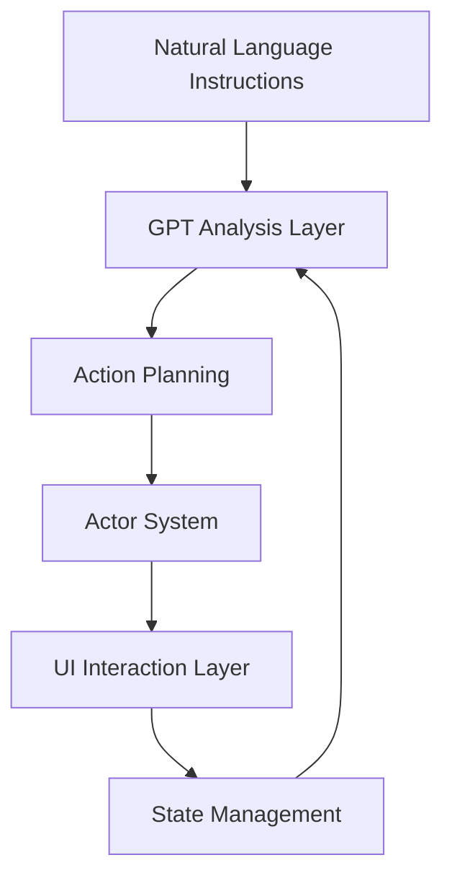

# 🤖 MacPilot - Marco de Automatización de UI Avanzado para macOS

<div align="center">

[](https://github.com/adeelahmad/macpilot/stargazers)
[](LICENSE)
[](https://www.python.org)
[](https://www.apple.com/macos)
[](CONTRIBUTING.md)

**Automatización nativa de UI de macOS con inteligencia impulsada por GPT**

[Características Principales](#-key-features) •
[Arquitectura](#%EF%B8%8F-architecture) •
[Instalación](#-installation) •
[Uso](#-usage) •
[Hoja de Ruta](#-roadmap) •
[Contribuir](#-contributing)

</div>

## 🌟 ¿Qué es MacPilot?

MacPilot es un framework de automatización de UI de vanguardia para macOS que combina tecnologías nativas de Apple con la inteligencia de GPT para permitir una interacción similar a la humana con tu Mac. Escribe instrucciones en inglés sencillo y deja que MacPilot se encargue de la automatización.

### Perfecto para:
- 🔄 **Automatización de Procesos** - Automatiza tareas repetitivas de UI
- 🧪 **Pruebas de UI** - Prueba aplicaciones de macOS
- 🤖 **RPA de Escritorio** - Desarrolla automatización robótica de procesos
- 🔍 **Análisis de Pantalla** - Extrae datos de elementos de UI
- 🧭 **Automatización de Flujos de Trabajo** - Crea flujos de trabajo complejos de UI

## ✨ Características Principales

### 🧠 Inteligencia Central
- **Integración con GPT** - Procesamiento de instrucciones en lenguaje natural
- **Vision Framework** - Detección avanzada de elementos de UI
- **Percepción de Estado** - Seguimiento del estado del sistema en tiempo real
- **Reconocimiento de Patrones** - Patrones de interacción de UI aprendidos
- **Autocorrección** - Recuperación automática de errores

### 🎯 Integración Nativa
- **Apple Vision** - OCR y detección de elementos nativos
- **AppleScript** - Integración profunda con el sistema operativo
- **API de Accesibilidad** - Control exhaustivo de la UI
- **Cocoa/AppKit** - Frameworks nativos de macOS
- **Core Graphics** - Captura de pantalla de bajo nivel

### 🛠 Experiencia de Desarrollador
- **Arquitectura Asíncrona** - Construida sobre Python asíncrono moderno
- **Seguridad de Tipos** - Validación completa con Pydantic
- **Sistema de Actores** - Ejecución modular de acciones
- **Gestión de Estado** - Seguimiento exhaustivo del estado de la UI
- **Sistema de Patrones** - Patrones de interacción reutilizables

### 🔄 Control de Aplicaciones
- **Control de Chrome** - Automatización profunda del navegador
- **Operaciones de Finder** - Automatización del sistema de archivos
- **Control del Sistema** - Operaciones a nivel de sistema operativo
- **Navegación de Menús** - Control de menús de aplicaciones
- **Gestión de Ventanas** - Control del estado de las ventanas

## 🏗️ Arquitectura



### Componentes Principales:
1. **Procesamiento de Instrucciones** - Análisis de instrucciones impulsado por GPT
2. **Gestión de Estado** - Seguimiento y validación del estado de la UI
3. **Sistema de Actores** - Ejecución modular de acciones
4. **Sistema de Patrones** - Patrones de interacción reutilizables
5. **Sistema de Visión** - Detección de elementos de UI y OCR
6. **Sistema de Recuperación** - Manejo automático de errores

## 🚀 Instalación

```bash
# Install from PyPI
pip install macpilot

# Or install from source
git clone https://github.com/adeelahmad/macpilot.git
cd macpilot
pip install -e .
```

## 📝 Uso

### Ejemplo Básico
```python
from macpilot import MacPilot

async def main():
    pilot = MacPilot()

    # Simple automation
    await pilot.execute("Open Chrome and search for 'Python tutorials'")

    # Complex workflows
    await pilot.execute("""
        1. Find all PDFs in Downloads
        2. Create a folder named 'Documents'
        3. Move PDFs older than 30 days
        4. Create a summary spreadsheet
    """)

if __name__ == "__main__":
    asyncio.run(main())
```

### Ejemplo de Patrón
```python
from macpilot.patterns import register_pattern

@register_pattern("login_flow")
async def handle_login(username: str, password: str):
    return [
        {"action": "click", "target": "username_field"},
        {"action": "type", "text": username},
        {"action": "click", "target": "password_field"},
        {"action": "type", "text": password},
        {"action": "click", "target": "login_button"}
    ]
```

## 📋 Lista de Tareas y Hoja de Ruta

### Alta Prioridad
- [ ] Interfaz de Usuario
  - [ ] Herramienta CLI para scripts de automatización
  - [ ] Panel web de monitoreo
  - [ ] Creador visual de flujos de trabajo

- [ ] Características Principales
  - [ ] Soporte para LLM locales
  - [ ] Recuperación de errores mejorada
  - [ ] Optimizaciones de rendimiento

### Prioridad Media
- [ ] Documentación
  - [ ] Referencia de la API
  - [ ] Biblioteca de patrones
  - [ ] Galería de ejemplos

- [ ] Pruebas
  - [ ] Aumentar la cobertura de pruebas
  - [ ] Pruebas de integración
  - [ ] Benchmarks de rendimiento

### Baja Prioridad
- [ ] Características Adicionales
  - [ ] Soporte para automatización de Safari
  - [ ] Monitoreo de solicitudes de red
  - [ ] Grabación de pantalla avanzada
  - [ ] Mercado de flujos de trabajo

## 🤝 Contribuir

¡Las contribuciones son bienvenidas! Áreas en las que nos estamos enfocando:

- 📝 Mejoras en la documentación
- 🧪 Pruebas y corrección de errores
- 🎯 Nuevos actores de aplicación
- 🔄 Implementaciones de patrones
- 🐛 Optimizaciones de rendimiento

Consulta nuestra [Guía de Contribución](CONTRIBUTING.md) para más detalles.

## 📜 Licencia

MacPilot está bajo licencia MIT. Consulta [LICENSE](LICENSE) para más detalles.

## 🙏 Agradecimientos

- Apple por las APIs de macOS
- OpenAI por los modelos GPT
- La comunidad de Python

<div align="center">

Hecho con ❤️ por el equipo de MacPilot

[🌐 Website](https://macpilot.dev) •
[📖 Documentation](https://docs.macpilot.dev) •
[💬 Discord](https://discord.gg/macpilot)

</div>
